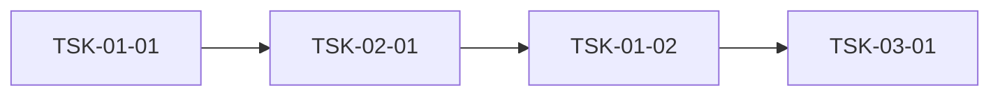

# 출력 형식 상세 (dflow-wbs 정본)

> 2026-10-19 전환: 출력은 **levels 계약 표기**다(frontmatter 단계 선언 + 헤딩 WP/ACT + 체크박스 Task + 들여쓴 상세 필드).
> 계약 정본 = `.claude/skills/dflow-wbs-nlevel/references/wbs-nlevel-md-contract.md` 「쓰기 규칙」·「표기 규약」.
> D-Flow 웹 파서(`src/lib/wbsmd/parse.ts`)와 스킬 검증기(`wbs-nlevel-parse.mjs`)가 같은 규칙으로 읽는다 —
> 이 형식이면 가져오기 화면의 "WBS 마크다운" 탭에 변환 없이 올라간다.
> 옛 표기(`### TSK-` 헤딩 + 열 0 `- field:` 줄)는 웹 탭이 읽지 못한다. 쓰지 않는다.

## 파일 골격

```markdown
---
project: {프로젝트명}
module: {DOCS_DIR 마지막 경로 세그먼트 — 예: docs/c10 → c10}
start_date: {YYYY-MM-DD}
levels:
  - { name: WP,      prefix: WP,  progress: rollup, report: weekly }
  - { name: Task,    prefix: TSK, progress: input }
  - { name: SubTask, prefix: STK, progress: checklist, optional: true, upload: fold }
---

# WBS - {프로젝트명}

> depth: {3|4}
> start-date: {시작} / target-date: {종료} / updated: {YYYY-MM-DD}

## WP-01: 프로젝트 초기화
- [ ] TSK-01-01: {Task명} w:{영업일} {시작}~{종료}
  - category: infra
  - domain: infra
  - model: sonnet
  - priority: critical
  - tags: setup
  - prd-ref: {PRD/TRD 절}
  - requirements: {요구 1}; {요구 2}
  - acceptance: {인수조건 1} / {인수조건 2}

## WP-{마지막}: 통합테스트
- [ ] TSK-{NN}-01: {시나리오 묶음} w:{영업일} {시작}~{종료}
  - category: itest
  - …

## 입력 매핑 리포트
(프로그램 리스트 모드만 — 표)

## 의존 그래프
(Mermaid + 통계 + 리뷰 후보 — 마지막 챕터 고정)
```

**4단계**는 levels 에 Activity 층을 넣고 WP 아래 `### ACT-` 헤딩을 둔다:

```markdown
levels:
  - { name: WP,       prefix: WP,  progress: rollup, report: weekly }
  - { name: Activity, prefix: ACT, progress: rollup }
  - { name: Task,     prefix: TSK, progress: input }
  - { name: SubTask,  prefix: STK, progress: checklist, optional: true, upload: fold }

## WP-03: 주문

### ACT-03-01: 주문 계약
- [ ] TSK-03-01-01: 주문 공유 계약 (계약 전용) w:1 2026-11-04~2026-11-04
  - category: infra
  - …
```

## frontmatter 규칙

- **파일 첫 줄이 `---`** 이다. 그 앞에 제목·빈 줄을 두지 않는다.
- `module` 필수, `^[A-Za-z0-9_-]{1,32}$`. 기본값 = `DOCS_DIR` 마지막 세그먼트(`/dflow-export` 의 module 과 같은 값 — 옛 형식으로
  올린 항목과 external_ref `module/ID` 가 같아 재업로드가 갱신이 된다). 세그먼트가 형식에 안 맞으면(한글 폴더 등) 사용자에게 영문 코드를 묻는다.
- `levels` 는 위 두 벌(3단계 / 4단계) 중 하나를 **그대로** 쓴다. 항목은 한 줄에 하나(여러 줄로 나누면 그 층이 빠진다).
  이름(`WP`·`Activity`·`Task`·`SubTask`)이 업로드 때 프로젝트의 WBS 단계 이름이 된다.
- `credits` 는 쓰지 않는다(이 스킬은 `credit:` 토큰을 만들지 않는다).
- frontmatter 안 주석은 줄 전체가 `#` 로 시작하는 것만. 줄 끝 `# 주석` 금지.

## Task 줄 — 체크박스 한 줄 + 토큰

```
- [ ] {TSK-ID}: {제목} @{담당 이메일} w:{가중치} {시작}~{종료}
```

| 토큰 | 규칙 |
|---|---|
| `- [ ]` | 상태. 생성은 항상 `[ ]` (전이 정본 = D-Flow). `[x]` 는 SubTask(STK) 전용 |
| `{TSK-ID}: {제목}` | ID 는 숫자 세그먼트만(`TSK-03-01`, 4단계 `TSK-03-01-01`). 제목에 `%`·` @`·` w:`·` ~YYYY-`·`YYYY-MM-DD~` 꼴을 넣지 않는다(토큰으로 떼어진다) |
| `@{이메일}` | 담당이 **이메일일 때만**. 아니면 토큰을 생략하고 「담당 미매칭」 표에 원문을 남긴다(references/dflow-integration.md) |
| `w:{N}` | 가중치 = 계획 영업일 수(일정 계산 결과). 0 보다 큰 수 |
| `{시작}~{종료}` | 계획 일정 `YYYY-MM-DD~YYYY-MM-DD`. 종료만 쓰지 않는다 — 산정한 시작·종료를 둘 다 쓴다 |

## 상세 블록 — Task 줄 밑 두 칸 들여쓴 `- key: value`

필드는 **열 가지뿐**이고 이 순서로 쓴다. 비었으면 **줄을 생략**한다(`-` 를 값으로 쓰지 않는다 — `depends: -` 는 `-` 라는 선행으로,
`priority: -` 는 업로드 거부로 이어진다).

| 키 | 값 |
|---|---|
| `category` | 7종 약어(`dev`·`defect`·`infra`·`feat`·`design`·`research`·`itest`) |
| `domain` | `fullstack`·`backend`·`frontend`·`database`·`infra`·`test`·`docs` 등 |
| `model` | `opus` 또는 `sonnet` |
| `priority` | `critical`·`high`·`medium`·`low` 중 하나(그 밖은 서버가 업로드 전체를 거부) |
| `tags` | `, ` 구분 |
| `depends` | 같은 파일 Task ID, `, ` 구분 (FS 전용) |
| `prd-ref` | PRD/TRD 절 참조 또는 `program:{프로그램ID}` |
| `entry-point` | `fullstack`·`frontend` Task 필수 — `{route} (메뉴: {모듈} > {화면})`. backend 는 줄 생략 |
| `requirements` | **한 줄.** 항목이 여럿이면 `; ` 로 잇는다 |
| `acceptance` | **한 줄.** 항목을 ` / ` 로 잇는다(항목 안에 ` / ` 를 쓰지 않는다) — 서버에서 항목 배열이 된다 |

- **한 필드 = 한 줄.** 필드 아래 하위 bullet(`    - 항목`)은 파서가 읽지 않는다.
- 옛 명세 필드의 자리:
  - `constraints` → requirements 끝에 `제약: …` 으로 붙인다.
  - `test-criteria` → acceptance 항목으로 붙인다.
  - `tech-spec`·`api-spec`·`data-model`·`ui-spec` → wbs.md 에 쓰지 않는다. TRD 가 정본이고 `prd-ref` 가 그 절을 가리킨다.
  - 입력 `note`(비고) → requirements 끝에 `비고: …`. model 을 올리고 내린 근거는 생성 리포트에 쓴다.
  - `status`·`assignee`·`schedule` 줄 → 체크박스·`@이메일`·`시작~종료` 토큰으로만 싣는다(줄로 쓰면 버려진다).
  - `blocked-by` → 쓰지 않는다(차단은 D-Flow 가 관리한다).
- **SubTask** = Task 줄 밑 두 칸 들여쓴 `- [ ] STK-{Task ID 꼬리}-{n}: …`. 노드로 안 올라가고 부모 Task 의 acceptance 로 접힌다.
  생성하지 않는다 — 사람이 필요할 때 단다.

## WP / ACT 헤딩

- `## WP-XX: {제목}` · (4단계) `### ACT-XX-YY: {제목}`. 헤딩 바로 아래 `- schedule:`·`- description:` 같은 필드 줄을 쓰지 않는다
  (WP 일정·진척은 하위 Task 에서 파생된다). 설명이 필요하면 `<!-- … -->` 를 별도 줄에 둔다.
- WP·ACT 에 담당 토큰을 붙이지 않는다(모듈 담당은 웹에서 지정).
- 4단계에서 Task 는 반드시 ACT 아래에 둔다(WP 직속 Task 는 검증 경고 "필수층 Activity 건너뜀").

## 통합테스트 Task 예

```markdown
## WP-{마지막 번호}: 통합테스트
- [ ] TSK-{NN}-01: {시나리오 묶음명 — 예: 등록→집계→리포트 흐름} w:5 {시작}~{종료}
  - category: itest
  - domain: test
  - model: sonnet
  - priority: high
  - tags: integration, e2e
  - depends: {시나리오가 관통하는 대표 기능 Task들}
  - requirements: {기능 간 흐름 시나리오}
  - acceptance: {시나리오 통과 기준} / 발견 결함은 해당 기능 WP 에 defect Task 로 등록된다
```

## 보고 장 (`## 입력 매핑 리포트`·`## 의존 그래프`) — 파일 끝

파서는 ID 없는 헤딩·표·문단·펜스를 건너뛴다. 단 아래는 읽어 버린다 — 보고 장에 쓰지 않는다:

- `- [ ]`·`- [x]`·`- [M]` 줄 (ID 가 없으면 검증 에러)
- 두 칸 이상 들여쓴 `- key: value` 줄 (마지막 Task 의 필드로 붙을 수 있다)
- `대문자ID: …` 꼴 헤딩(`## API: …`) — 미선언 접두어 에러
- 펜스 안이어도 위 줄은 읽힌다(파서는 펜스를 따로 보지 않는다)

보고 장은 **표·문단·mermaid** 로만 쓴다.

### 의존 그래프 챕터

> 의존 그래프 검증 결과를 기록한다. 파일 **마지막 챕터**(모든 WP·Task 뒤). Mermaid 블록은 `mermaid` 펜스.



노드 스타일 규칙:
- 계약 전용 Task: `style TSK-01-02 fill:#e8f5e9,stroke:#2e7d32`
- 구현 포함 선행 Task: `style TSK-01-03 fill:#fff3e0,stroke:#e65100`
- 리뷰 후보(아래 `review_candidates`): `style TSK-XX stroke:#c62828,stroke-width:2px`

**통계** 표:

| 항목 | 값 | 임계값 |
|------|-----|--------|
| 최장 체인 깊이 | {max_chain_depth} | 3 초과 시 검토 (공정 양끝 +2 는 구조 비용 허용) |
| 전체 Task 수 | {total} | — |
| Fan-in ≥ 3 Task 수 | {fan_in_ge_3_count} | 계약 추출 후보 (모듈 계약·itest Task 는 구조적 예외) |
| Diamond 패턴 수 | {diamond_count} | 자주 발생 시 apex 계약 추출 |

**Fan-in Top 5**: `| Task | Fan-in | 계약 추출 가능? |` 표. **Diamond 패턴**: `| Apex | 분기 | Merge |` 표.

**리뷰 후보** — 후보마다 "계약 추출로 해소 가능" 또는 "진짜 구현 의존이라 유지" 를 표로 명시한다.

| Task | 신호 | 판정 | 근거 |
|------|------|------|------|
| TSK-03-03 | depends=5 | 유지 | 실제 5개 시스템 상태 변경을 원자적으로 조합해야 함 |

**후보 없으면 "검토 결과 후보 없음" 명시.** 이 섹션 비움 금지.
